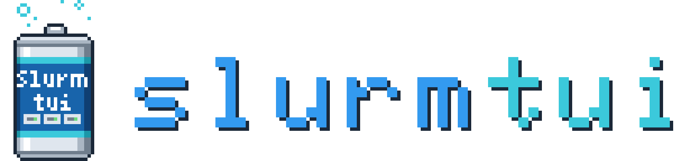

<p align="center"></p>

# slurmtui

A terminal UI for Slurm in the style of k9s. It runs on your laptop and talks only to slurmrestd (API v0.0.45, Slurm 26.05), so you need no Slurm, munge or `slurm.conf` on your machine.

<!-- screenshot -->

## Features

- Overview: nodes on top, jobs under them. `:nodes` and `:jobs` show one list on the full screen.
- Problem nodes first: down, then drained and draining, with reason, user and age.
- Drain, edit reason, resume a node. Cancel a job. Each action has a confirm dialog.
- Describe and raw JSON for a node or a job.
- Regex filter, sort, node-to-jobs scope, refresh at a fixed interval.
- Provided token (`scontrol token`) or Signed token (from the Cluster key).
- Read-only mode.
- Setup form on first start.

## Install

```sh
nix run github:awalvie/slurmtui      # run once
nix build github:awalvie/slurmtui    # binary in ./result/bin/slurmtui
go install github.com/awalvie/slurmtui/cmd/slurmtui@latest   # Go 1.26.7 or later
```

## Quick start

Open a tunnel to slurmrestd, get a token, and start in read-only mode:

```sh
ssh -fN -L 6820:slurmrestd.example:6820 login.example
export SLURM_JWT=$(ssh login.example scontrol token lifespan=3600 | sed 's/^SLURM_JWT=//')
slurmtui --url http://127.0.0.1:6820 --readonly
```

`--user` is optional: slurmtui reads the user from the token.

If you start slurmtui with no flags and no config file, a setup form opens. It tests the connection with `GET /slurm/v0.0.45/ping`, then adds a Context to the config file. A pasted token is used for that session only and is never saved.

The terminal must be at least 80x24.

## Read-only mode

Start with `--readonly` on a production cluster. In read-only mode, slurmtui sends only GET requests, and `D`, `U` and `ctrl-d` do nothing.

| Source | Example |
|---|---|
| Flag | `--readonly`, or `--write` to override a read-only Context |
| Context | `readOnly: true` |
| Global | `slurmtui.readOnly: true` |

The flag wins, then the Context, then the global setting. The default is off. `--readonly` and `--write` together are an error.

## Flags

| Flag | Meaning |
|---|---|
| `--context <name>` | Context from the config file. Required when the file has more than one. |
| `--url <url>` | slurmrestd URL. Without `--context`, makes a Context named after the URL host, with the token in `SLURM_JWT`. |
| `--user <name>` | Slurm user. Replaces the user of the Context. |
| `-r`, `--refresh <s>` | Refresh interval in whole seconds, at least 2. Default 5. |
| `--readonly` | Read-only mode. |
| `--write` | Allow actions, also for a read-only Context. |

## Config

Path: `$XDG_CONFIG_HOME/slurmtui/config.yaml` (default `~/.config/slurmtui/config.yaml`). `SLURMTUI_CONFIG_DIR` replaces the directory.

```yaml
slurmtui:
  refreshRate: 5          # seconds, at least 2
  readOnly: false         # global default
  contexts:
    prod:
      url: https://slurm.example:6820
      caFile: ~/.config/slurmtui/prod-ca.pem
      user: alice
      keyFile: keys/prod.key      # Signed token
      readOnly: true
    lab:
      url: http://127.0.0.1:6820
      tokenEnv: SLURM_JWT_LAB     # Provided token
```

| Field | Rule |
|---|---|
| `url` | `https`, or `http` to `127.0.0.1`, `::1` or `localhost` only. |
| `caFile` | PEM file with one or more CA certificates, added to the system roots. |
| `user` | Required with `keyFile`. Optional with `tokenEnv`. |
| `keyFile` / `tokenEnv` | Exactly one of the two. |
| `readOnly` | `true` or `false`. |

- `~` and `~/` expand. `~user` is an error. Relative paths start from the config directory.
- If the file has one Context, slurmtui uses it. If it has more, `--context` is required.
- An incorrect file stops slurmtui before the UI opens. The error gives the line and the field, for example `line 7: slurmtui.contexts.prod.password: unknown field`.
- Only the setup form writes the file. It only adds a Context and keeps the rest of the file, comments included.

## Auth

| | Provided token | Signed token |
|---|---|---|
| Config | `tokenEnv` (default `SLURM_JWT`) | `keyFile` |
| Source | `scontrol token` on the cluster | slurmtui signs HS256 with the Cluster key |
| User | the `sun` claim of the token | `user` or `--user` |
| Lifetime | the `exp` of the token, shown as `Expires` in the header | a new token for each request, valid 5 minutes |
| Use when | `scontrol token` works | the cluster sets `disable_token_creation` |

**Provided token.** slurmtui reads `sun` and `exp` from the token and does not verify the signature. A `user` or `--user` that differs from `sun` is a startup error. When the token expires, refresh stops. Get a new token and restart.

**Signed token.** The Cluster key is the file that `AuthAltParameters=jwt_key=` names in `slurm.conf`.

> **WARNING:** Keep the Cluster key like a root password. The key can sign a token for every user, root included.

Key file rules:

- The key comes only from a file, never from a flag or env var.
- Symlinks are followed (agenix, sops-nix).
- The file must be a regular file, owned by you, with no group or other permissions (`chmod 600`), and not empty.
- slurmtui uses the bytes as they are, as slurmctld does.

**Check the clock.** slurmctld checks `exp` with no leeway. If your clock is more than 5 minutes slow, every request fails, and the error tells you to check the clock and the key. A fast clock does no harm.

## Transport

- `https` is verified against the system roots plus `caFile`. There is no skip-verify.
- `http` is allowed only to a loopback host, for an SSH tunnel.
- Redirects are refused. The token headers do not go to the redirect target.

## Keys

`?` shows the keys in the UI. The header shows the keys of the focused pane.

**Both panes**

| Key | Action |
|---|---|
| `tab`, `shift-tab` | Move the focus between the Nodes and Jobs panes |
| `j`/`k`, `down`/`up` | Move |
| `g` / `G` | Top / bottom |
| `d` | Describe |
| `y` | Raw JSON |
| `/` | Filter by regex. `!x` inverts. `enter` keeps, `esc` undoes. |
| `esc` | Clear the filter, then the node scope. In a full-screen view, go back. |
| `shift-n` / `shift-s` | Sort by name / state. Again to reverse. |
| `ctrl-r` | Refresh now |
| `?` | Help |

**Nodes pane**

| Key | Action |
|---|---|
| `enter` | Show the jobs on the node in the Jobs pane |
| `D` | Drain. On a drained node: edit the reason. |
| `U` | Resume |

**Jobs pane**

| Key | Action |
|---|---|
| `enter` | Describe |
| `ctrl-d` | Cancel. An array record cancels all tasks. A het job component cancels all components. |
| `o` | Nodes of the job (full-screen `:jobs` only) |

**Describe, JSON**

| Key | Action |
|---|---|
| `j`/`k`, `down`/`up`, `g`/`G` | Scroll |
| `esc` | Back |

**Dialogs**

| Key | Action |
|---|---|
| `tab`, `shift-tab` | Next / previous field or button |
| `left` / `right` | Move between buttons |
| `enter` | Push the focused button |
| `esc` | Keep (no change) |

**Setup form**

| Key | Action |
|---|---|
| `tab`, `shift-tab`, `down`, `up` | Move between fields |
| `left`/`right`, `h`/`l`, `space` | Change the token source |
| `ctrl-u` | Clear the field |

**Commands**

| Key | Action |
|---|---|
| `:nodes`, `:no` | Nodes on the full screen |
| `:jobs`, `:j` | Jobs on the full screen |
| `:overview`, `:ov` | Back to the Overview |
| `:q`, `ctrl-c` | Quit |

## Security

- Tokens and the Cluster key never show in output, logs, errors or crash output. Errors name the URL, never headers.
- The config file holds only a URL, a CA file path, a user, and a key file path or env var name. Never a token or a key.
- The setup form creates the config directory with mode 0700 and the file with mode 0600.
- slurmtui does not check permissions or state before an action. Slurm decides, and its error shows in the bottom line.

## Develop

| Command | Does |
|---|---|
| `nix develop` | Dev shell: Go, gopls, golangci-lint, just |
| `just check` | gofmt, vet, no-comments check, lint, tests. CI and the pre-commit hook run the same script. |
| `just hooks` | Enable the pre-commit hook |
| `just test` | Tests, without the integration tests |
| `just run --url <url> --user <user>` | Run from source, with `SLURM_JWT` set |
| `just build` | `nix build` |
| `just openapi-spec` | Make `testdata/slurm-26.05/openapi-slurmctld-v0.0.45.json` again from the nixpkgs slurmrestd |

After a change to `go.mod`, set `vendorHash` in `flake.nix` to `pkgs.lib.fakeHash`, run `nix build`, and use the hash it reports. A stale hash builds from stale modules.

Real Slurm 26.05 cluster in Docker (3 nodes, slurmrestd on `127.0.0.1:6820`, config in `dev/compose/`):

```sh
just cluster-up      # build the image with Nix, start the cluster
just cluster-wait    # wait for slurmctld, slurmd and slurmrestd
just cluster-seed    # submit sample jobs, drain c3
just cluster-run     # run slurmtui as root against it
just cluster-test    # integration tests (TestRealCluster*)
just cluster-token   # print a token (user=root lifespan=3600)
just cluster-down    # stop and remove volumes
```

Docs for contributors: [docs/README.md](docs/README.md). Commits use Conventional Commits.

## License

MIT. See [LICENSE](LICENSE).
