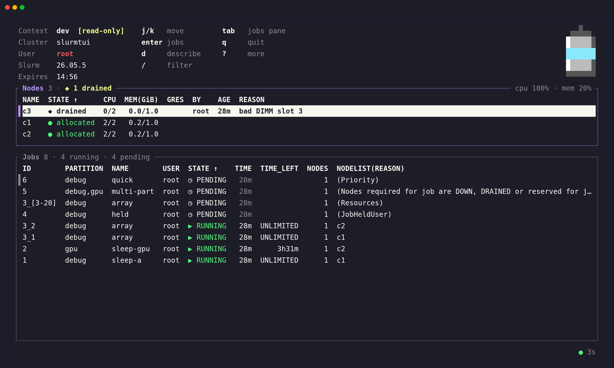
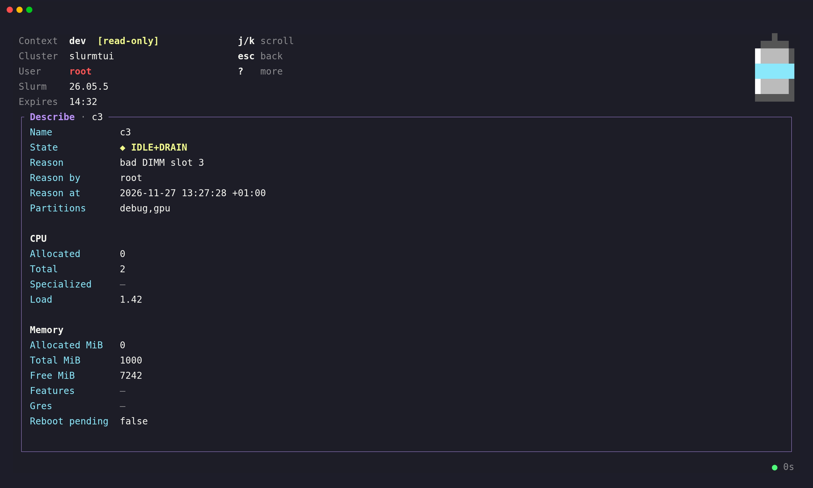

<p align="center">
  
</p>

<p align="center">A k9s-style terminal UI for Slurm, over slurmrestd.</p>

<p align="center">
  <a href="#install">Install</a> &nbsp;|&nbsp;
  <a href="#quick-start">Quick start</a> &nbsp;|&nbsp;
  <a href="#keys">Keys</a> &nbsp;|&nbsp;
  <a href="#config">Config</a> &nbsp;|&nbsp;
  <a href="#develop">Develop</a>
</p>

<p align="center">
  
</p>

<table>
  <tr>
    <td width="33%" align="center"><br><sub>Drain</sub></td>
    <td width="33%" align="center"><br><sub>Describe</sub></td>
    <td width="33%" align="center"><br><sub>Setup</sub></td>
  </tr>
</table>

## Install

Needs slurmrestd with API v0.0.45 (Slurm 26.05).

**Nix**

```sh
nix run github:awalvie/slurmtui
```

**Go**

```sh
go install github.com/awalvie/slurmtui/cmd/slurmtui@latest
```

## Quick start

With no flags, slurmtui opens a setup form and saves a context:

```sh
slurmtui
```

With a token:

```sh
export SLURM_JWT=eyJhbGciOi...
slurmtui --url https://slurm.example:6820
```

To get a token, run this on a cluster node:

```sh
scontrol token lifespan=86400   # prints SLURM_JWT=...
```

`lifespan` is in seconds. If you have the cluster JWT key (`jwt_hs256.key`), set `keyFile` and `user` in the config. slurmtui then makes its own tokens.

| Flag | Does |
|---|---|
| `--url` | slurmrestd URL |
| `--context` | Use a context from the config file |
| `--user` | Slurm user name |
| `--refresh`, `-r` | Refresh interval in seconds (default 5) |
| `--readonly` | No drain, resume or cancel |
| `--write` | Allow actions, also for a read-only context |

## Keys

`?` shows all keys.

**Move**

| Key | Does |
|---|---|
| `j` `k` | Up and down |
| `g` `G` | First and last row |
| `tab` | Other pane |
| `esc` | Clear the filter, then the scope, then back |
| `q` | Quit |

**Look**

| Key | Does |
|---|---|
| `enter` | Jobs on the node, or describe the job |
| `o` | Nodes of the job |
| `d` | Describe |
| `y` | Raw JSON |
| `/` | Filter (regex, `!` inverts) |
| `shift-n` `shift-s` | Sort by name or state |
| `ctrl-r` | Refresh now |
| `:nodes` `:jobs` `:ov` | Nodes, jobs or both |

**Act**

| Key | Does |
|---|---|
| `D` | Drain the node |
| `U` | Resume the node |
| `ctrl-d` | Cancel the job |

## Config

slurmtui reads `~/.config/slurmtui/config.yaml`. Each context is one cluster.

```yaml
slurmtui:
  refreshRate: 5                  # seconds, for all contexts
  readOnly: false                 # true: no drain, resume or cancel
  contexts:
    prod:
      url: https://slurm.example:6820
      caFile: prod-ca.pem         # CA certificate for TLS
      user: alice
      keyFile: keys/prod.key      # JWT key: slurmtui makes the token
      readOnly: true              # only for this context
    dev:
      url: http://127.0.0.1:6820
      tokenEnv: SLURM_JWT         # environment variable with the token
```

Relative paths start from the config directory. Pick a context with `slurmtui --context prod`.

## Develop

```sh
nix develop         # toolchain
just check          # format, vet, lint, tests
```

3-node Slurm cluster in Docker:

```sh
just cluster-up
just cluster-wait
just cluster-seed
just cluster-run    # slurmtui against it
```

Design docs are in [docs/](docs/README.md).

## License

[MIT](LICENSE)
