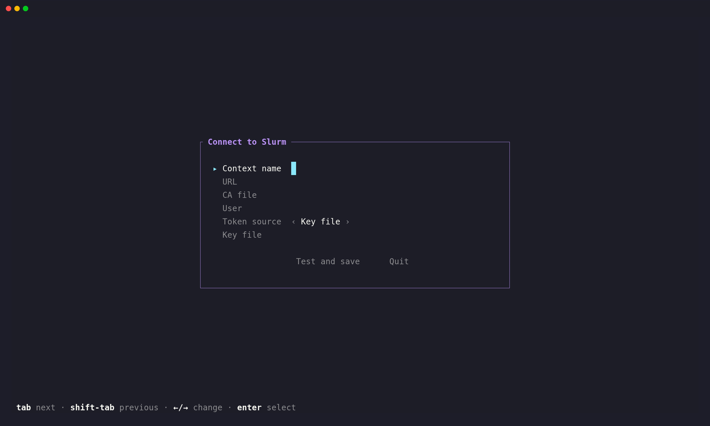
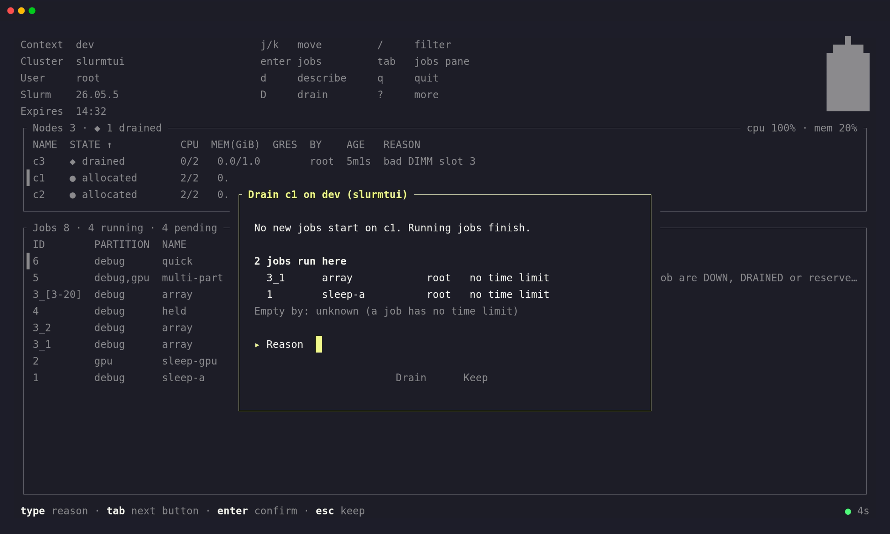

<p align="center"></p>

# slurmtui

A k9s-style terminal UI for Slurm. It shows nodes and jobs, drains and resumes nodes, and cancels jobs.

slurmtui connects only to slurmrestd (Slurm 26.05, API v0.0.45). Your computer does not need Slurm, munge or `slurm.conf`.


## Install

Nix:

```sh
nix run github:awalvie/slurmtui
```

Go 1.26.7 or later:

```sh
go install github.com/awalvie/slurmtui/cmd/slurmtui@latest
```

Source:

```sh
git clone https://github.com/awalvie/slurmtui
cd slurmtui
nix build        # or: go build ./cmd/slurmtui
```

## Start

Run `slurmtui`. At the first start, a form asks for the slurmrestd URL, the user and the token source. slurmtui tests the connection and saves a context.



With a token:

```sh
export SLURM_JWT=$(ssh login-node scontrol token lifespan=28800 | cut -d= -f2)
slurmtui --url https://slurm.example:6820 --readonly
```

With a local test cluster in Docker:

```sh
just cluster-up && just cluster-wait && just cluster-seed && just cluster-run
```

On a production cluster, use `--readonly`. slurmtui then sends only GET requests.

## Keys

The header shows the keys for the current pane. `?` shows all keys.

| Key | Action |
|---|---|
| `tab` | Go to the other pane |
| `j` `k` `g` `G` | Move |
| `enter` | Node: show its jobs. Job: describe. |
| `o` | Show the nodes of a job |
| `d` / `y` | Describe / raw JSON |
| `/` | Filter (regex; `!` inverts) |
| `shift-n` / `shift-s` | Sort by name / state |
| `D` / `U` | Drain / resume a node |
| `ctrl-d` | Cancel a job |
| `ctrl-r` | Refresh |
| `:nodes` `:jobs` `:ov` | Nodes only, jobs only, both |
| `esc` | Back |
| `q` | Quit |

Each action shows a confirm dialog first.



## Config

`~/.config/slurmtui/config.yaml`, or `$SLURMTUI_CONFIG_DIR/config.yaml`:

```yaml
slurmtui:
  refreshRate: 5
  contexts:
    prod:
      url: https://slurm.example:6820
      caFile: ~/.config/slurmtui/prod-ca.pem
      user: alice
      keyFile: keys/prod.key
      readOnly: true
    lab:
      url: http://127.0.0.1:6820
      tokenEnv: SLURM_JWT_LAB
```

With two or more contexts, select one with `--context`. Relative paths start from the config directory. `slurmtui -h` shows the flags.

## Tokens

Each context has one token source:

- `tokenEnv`: an environment variable with a token from `scontrol token`. The header shows its expiry time.
- `keyFile`: the cluster JWT key (`AuthAltParameters=jwt_key=`). slurmtui signs a new token for each request. Use this when the cluster sets `disable_token_creation`.

The JWT key can sign a token for all users, including root. Keep it like a root password. slurmtui reads it only from a file that you own and that no other user can read.

If all requests fail with a signed token, examine your clock. Slurm refuses the token when your clock is more than 5 minutes slow.

## Security

- Tokens and keys do not show in output, logs or errors.
- The config file does not store tokens or keys.
- slurmtui always verifies https certificates. Plain http works only to localhost, for an SSH tunnel: `ssh -L 6820:localhost:6820 login-node`.
- slurmtui refuses redirects, so a token does not go to a different host.

## Develop

```sh
nix develop       # Go, golangci-lint, just
just check        # format, vet, lint, tests (also pre-commit and CI)
just hooks        # enable the pre-commit hook
just cluster-up   # 3-node Slurm in Docker on 127.0.0.1:6820
just cluster-test # integration tests
just screenshots  # make assets/screenshots again
```

After a change to `go.mod`, set `vendorHash` in `flake.nix` to `pkgs.lib.fakeHash`, run `nix build`, and use the hash that it shows.

Design docs: [docs/](docs/README.md).

## License

MIT
